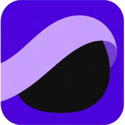

<p align="center">
  
</p>

<h1 align="center">ScreenOff</h1>

<p align="center">Black out every monitor while your apps keep running.</p>

<p align="center">
  <a href="#use-screenoff"></a>
  <a href="#build-from-source"></a>
  <a href="LICENSE"></a>
</p>

## About ScreenOff

ScreenOff is a small, portable Windows app for when you want a dark screen without interrupting work in the background. It fills every active display with pure black (`#000000`), hides the pointer, and asks Windows to keep the displays awake during the blackout.

## Download ScreenOff

- [Portable ZIP for Windows 11 x64](https://github.com/lonixchu-hk/ScreenOff/releases/latest/download/ScreenOff-windows-x64.zip) includes `ScreenOff.exe`, `ScreenOff Settings.cmd`, and the MIT license.
- [Complete ZIP for Windows 11 x64](https://github.com/lonixchu-hk/ScreenOff/releases/latest/download/ScreenOff-complete-windows-x64.zip) also includes the source code, build script, artwork, and this README.

## Use ScreenOff

Extract the ZIP and open `ScreenOff.exe` to start blackout. To return to your desktop with the default settings, **double-click the left mouse button** or **tap Space twice quickly**.

Both default gestures use the Windows double-click timing. The desktop returns after the second release, and ScreenOff consumes the clicks or key presses so they stay out of the app underneath. With default settings, a single click, mouse movement, or holding Space keeps the blackout active.

## Configure ScreenOff

Opening `ScreenOff.exe` starts blackout immediately without opening Settings. To configure ScreenOff, keep `ScreenOff Settings.cmd` beside the executable and open it separately. You can also run `ScreenOff.exe --settings` or open Settings from the tray icon while the shortcut listener is running. Settings are saved for your Windows account.

- **Exit blackout** lets you choose a single or double click with the left or right mouse button and a key to tap twice. You can turn either method off and must keep at least one enabled.
- **Start blackout shortcut** lets you select **Record**, press a shortcut such as `Ctrl+Alt+B`, and select **Save**. Press the shortcut from another app to start blackout. The notification area icon stays available between blackouts. Double-click the icon to reopen Settings or right-click to quit the listener.
- **Start shortcut listener at sign-in** is optional. If you move the executable, reopen Settings and re-enable this option from its new location. Select **Clear** and **Save** to disable the shortcut.

## How it works

ScreenOff uses a dedicated Win32 desktop to isolate ordinary keyboard and mouse input and keep your regular desktop and its notifications out of view. Windows retains control of secure screens such as `Ctrl+Alt+Del`.

The display signal stays active during normal operation. An LCD may still emit some backlight even when it displays pure black.

## Build from source

Install the MSVC x64 C++ build tools and a Windows SDK through Visual Studio Build Tools. Run `build.cmd` from the project folder in PowerShell.

```powershell
.\build.cmd
```

The build produces `ScreenOff.exe` with the embedded Veil application icon. Run the gesture tests with `build.cmd test`.

```powershell
.\build.cmd test
```

## License

ScreenOff is available under the [MIT License](LICENSE).
