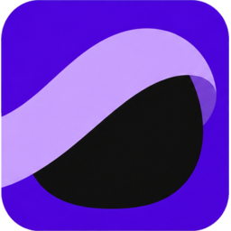
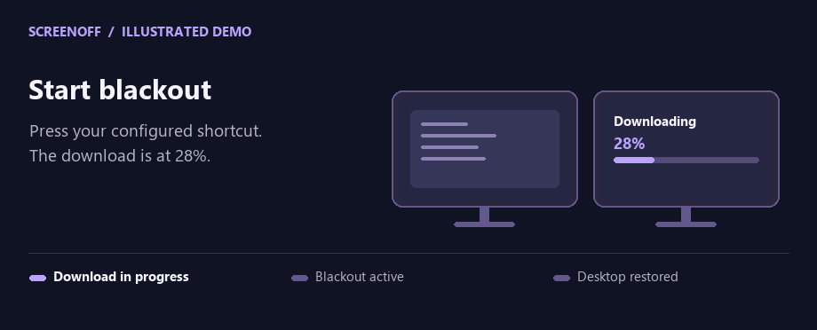

<p align="center">
  
</p>

<h1 align="center">ScreenOff</h1>

<p align="center">Black out every monitor while your apps keep running.</p>

<p align="center">
  <strong><a href="https://github.com/lonixchu-hk/ScreenOff/releases/latest/download/ScreenOff-Setup.exe">Download for Windows 11 x64</a></strong>
  · <a href="https://github.com/lonixchu-hk/ScreenOff/releases/latest">Release notes</a>
</p>

<p align="center">Unsigned installer · No administrator access required</p>

<p align="center">
  
</p>

<p align="center">If ScreenOff is useful to you, give it a star on <a href="https://github.com/lonixchu-hk/ScreenOff">GitHub</a>.</p>

## About ScreenOff

Use ScreenOff when you want a dark screen while a download, render, or other task keeps running. It fills every active display with pure black (`#000000`), hides the pointer, and asks Windows to keep the displays awake during the blackout.

## Download ScreenOff

Run **ScreenOff-Setup.exe** to install the **ScreenOff** and **ScreenOff Settings** shortcuts for your Windows account. To uninstall, open **Settings → Apps → Installed apps**.

If you used a portable ZIP, quit its tray listener before installing. Setup keeps your saved settings and moves an enabled sign-in shortcut to the installed copy.

## Use ScreenOff

Open **ScreenOff** from the Start menu to start blackout. To return to your desktop with the default settings, **double-click the left mouse button** or **tap Space twice quickly**.

Both default gestures use the Windows double-click timing. The desktop returns after the second release, and ScreenOff consumes the clicks or key presses so they stay out of the app underneath. With default settings, a single click, mouse movement, or holding Space keeps the blackout active.

## Configure ScreenOff

Open **ScreenOff Settings** from the Start menu or the installation folder. You can also choose **Setting** from the tray icon while the shortcut listener is running. If you build from source, use `Setting.cmd` or run `ScreenOff.exe --settings`. Settings are saved for your Windows account.

- **Exit blackout** lets you choose a single or double click with the left or right mouse button and a key to tap twice. You can turn either method off and must keep at least one enabled.
- **Start blackout shortcut** lets you select **Record**, press a shortcut such as `Ctrl+Alt+B`, and select **Save**. Press the shortcut from another app to start blackout. The notification area icon stays available between blackouts. Double-click the icon to reopen Settings or right-click to quit the listener.
- **Start blackout after inactivity** is off by default. Select a delay and confirm that ScreenOff can turn off the Windows screen saver for your account. Detected audio or video playback delays automatic blackout. Some muted or silent videos may go undetected.
- **Start ScreenOff at sign-in** starts the listener for either your shortcut or automatic blackout. If you move the executable, reopen Settings from its new location and re-enable this option.

## How it works

ScreenOff uses a dedicated Win32 desktop to isolate ordinary keyboard and mouse input and keep your regular desktop and its notifications out of view. Windows retains control of secure screens such as `Ctrl+Alt+Del`.

The display signal stays active during normal operation. An LCD may still emit some backlight even when it displays pure black.

## Build from source

Install the MSVC x64 C++ build tools and a Windows SDK through Visual Studio Build Tools. Run `build.cmd` from the project folder in PowerShell.

```powershell
.\build.cmd
```

The build produces `ScreenOff.exe` with the embedded Veil application icon. Run the gesture tests with `build.cmd test`.

```powershell
.\build.cmd test
```

## Build the installer

Install [Inno Setup 6.3 or later in the 6.x series](https://jrsoftware.org/isdl.php). If you installed it in a custom location, add its directory to `PATH`. Pass the release version without the leading `v` (for example, `1.2.0`).

```powershell
.\build.cmd installer 1.2.0
```

Upload `dist/ScreenOff-Setup.exe` as the release's only uploaded download.

## License

ScreenOff is available under the [MIT License](LICENSE).
